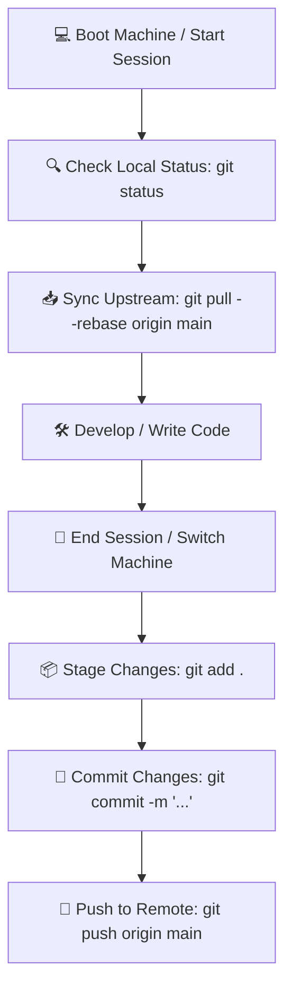

# Multi-Device Git Workflow Guide

This document defines standardized Git synchronization protocols for developers alternating work between multiple environments (e.g., **Office Workstation** and **Remote / Home Machine**), preventing merge conflicts, lost work, and divergent branches.

---

## 🎯 Common Multi-Device Challenges

1. **Forgetting to push at end of day** on Machine A leaves Machine B with an outdated working copy.
2. **Forgetting to pull before starting work** on Machine B creates divergent Git history branches.
3. **Uncommitted local changes** block incoming pull operations and cause merge conflicts.

---

## ⭐️ The 3 Golden Rules

> 1. **Start of Work = Always `Pull`:** Fetch and rebase the latest upstream changes before touching code.
> 2. **End of Work = Always `Push`:** Commit and push all progress to GitHub before closing your session.
> 3. **Use `Rebase` over Plain Merge:** Keeps linear, readable commit history without redundant merge commits.

---

## 🔄 Daily Workflow Lifecycle



### 1️⃣ Starting Your Session (Start of Day / Switching Machines)

Before modifying any source files, execute the following commands:

```bash
# 1. Check for uncommitted working tree changes
git status

# 2. Fetch remote branch updates
git fetch origin

# 3. Fast-forward local branch with rebase
git pull --rebase origin main
```

---

### 2️⃣ Concluding Your Session (End of Day / Leaving Machine)

When development is complete or before switching to your other machine:

```bash
# 1. Inspect modified and untracked files
git status

# 2. Stage changes
git add .

# 3. Create descriptive commit message
git commit -m "feat: implement production order tracking updates"

# 4. Push to GitHub
git push origin main
```

--- 

## 🛠️ Common Troubleshooting Scenarios

### Scenario A: Started editing code locally before pulling upstream updates!

**Resolution (Leverage Git Stash):**

```bash
# 1. Temporarily stash uncommitted local work
git stash

# 2. Pull latest upstream commits with rebase
git pull --rebase origin main

# 3. Re-apply stashed work on top of latest history
git stash pop
```
*(If merge conflicts occur, resolve conflict markers, run `git add .`, and continue).*

---

### Scenario B: `git push` rejected (Non-fast-forward conflict)

Occurs when another machine pushed new commits to GitHub earlier.

**Resolution:**

```bash
# Rebase incoming commits beneath your local work
git pull --rebase origin main

# Retry push operation
git push origin main
```

---

## ⚙️ Recommended Local Git Configuration

Run these commands **once per machine** in your terminal:

```bash
# Configure git pull to default to rebase mode
git config --global pull.rebase true

# Automatically prune deleted remote branches on fetch
git config --global fetch.prune true

# Set standard default branch name to main
git config --global init.defaultBranch main
```

---

## 📜 Git Quick Reference (Cheat Sheet)

| Command | Operational Purpose | When to Use |
| :--- | :--- | :--- |
| `git status` | Inspect working directory and staged status | Regularly throughout the day |
| `git pull --rebase origin main` | Synchronize upstream commits with linear history | **Start of every session** |
| `git add .` | Stage modified files for commit | Prior to committing |
| `git commit -m "message"` | Record changes with descriptive commit log | End of work tasks |
| `git push origin main` | Publish commits to remote GitHub repository | **End of every session** |
| `git stash` / `git stash pop` | Temporarily shelve uncommitted work / Restore | Recovering from forgotten pulls |
| `git log --oneline -n 5` | Review the 5 most recent commit summaries | Verification and audit |

---

> 💡 **Quick Reminder:**  
> **"Start Session = Pull | End Session = Push"** 🚀
