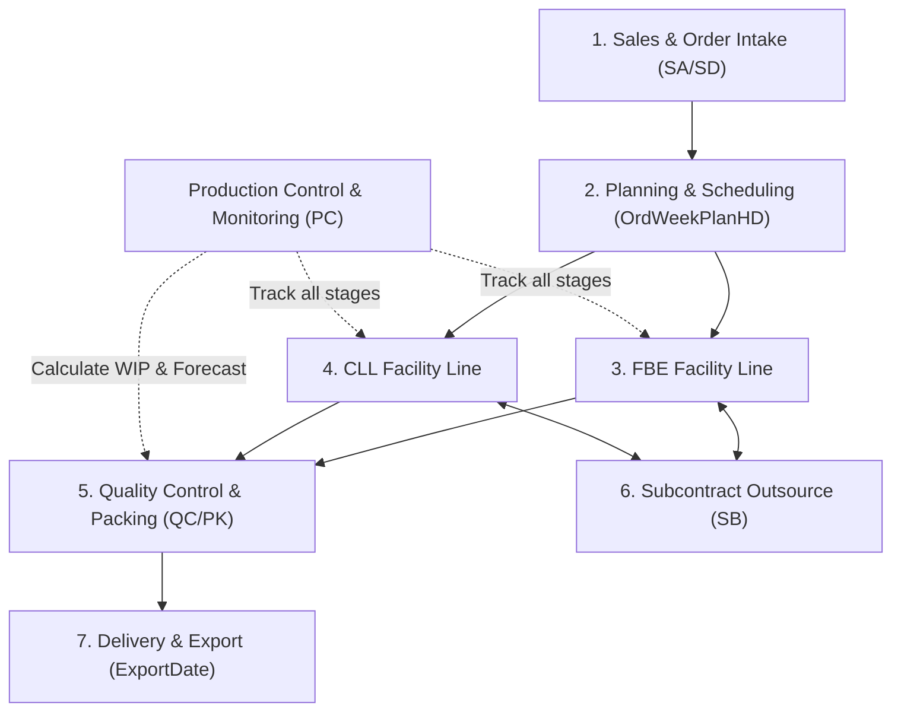
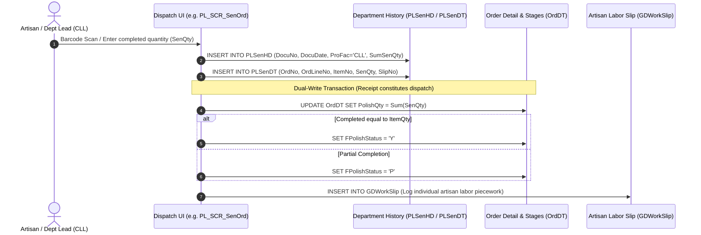

# Legacy System Architecture & Operational Workflows (PCC Management System)

> **In-Depth Architectural Reference:** Summary and technical deconstruction of workflows, data storage repositories, data flow pipelines, and database tables derived from the legacy production codebase.

---

## 1. System Overview & Tech Stack

* **Application Type:** Windows Forms Application (.NET Framework / Visual Basic .NET)
* **Reporting Engine:** Crystal Reports 13 (`CrystalDecisions.CrystalReports.Engine`)
* **Primary Database Server:**
  * **Server:** `<DB_SERVER>` (Configured via database connection profiles)
  * **Database:** `dbGeneration` (Core manufacturing execution and order repository)
  * **Auxiliary Databases:** `CostDB`, `dbEnterprise`, `dbInventory`, `dbStock`, `dbTempStock`
* **External File Storage:**
  * High-Resolution Jewelry / Casting Photos: `\\<FILE_SERVER>\Photo\...`
  * PO Work Queues and Attachments: `\\<FILE_SERVER>\Queue\...`

---

## 2. Core Modules in Legacy System

The production system is partitioned into **7 operational pillars**:



1. **Sales & Order Processing (SA / SD):** Customer PO intake, SKU configuration, and production order creation.
2. **Planning & Scheduling (ORD / Plan):** Weekly production quota scheduling (`OrdWeekPlanHD`).
3. **FBE Facility Production (`FBE_*`):** Formal dual-custody production flow (separate Receive `Rec` and Send `Sen` dockets).
4. **CLL Facility Production (`*_SCR` / `*_SCN`):** Station milestone production (**"Receipt constitutes dispatch"** milestone model).
5. **Subcontract Management (SB):** External artisan job assignments and material tracking.
6. **QC & Packing (QC / QP / PK):** Multi-tier quality control and barcode packaging.
7. **Production Control & Order Tracking (PC):** Centralized multi-department WIP tracking and expediting.

---

## 3. Operational Comparison: FBE vs. CLL Facilities

Fundamental architectural differences between **FBE** and **CLL** facilities uncovered in source analysis:

| Operational Dimension | FBE Facility (`ProFac = 'FBE'`) | CLL Facility (`ProFac = 'CLL'`) |
| :--- | :--- | :--- |
| **System UI Screens** | Prefixed with `FBE_` (e.g. `FBE_PL_SCR_SenOrd.vb`, `FBE_FL_SCR_SenOrd.vb`) | Standard screens (e.g. `PL_SCR_SenOrd.vb`, `FL_SCN_SenOrd.vb`, `PT_SCN_SenOrd.vb`) |
| **Table Schema** | **Dual-sided:** Send tables `{Step}SenHD/DT` and Receive tables `{Step}RecHD/DT` | **Single-sided:** Send tables `{Step}SenHD/DT` only (No `*Rec` tables maintained) |
| **Transaction Behavior** | **Formal Handover:** Dept A dispatches `Sen` ➔ Dept B scans receipt `Rec` | **Station Milestone:** **"Receipt constitutes dispatch"**—single scan completes stage |
| **Order Line Updates** | Logged as custody transfer history in `Rec`/`Sen` tables | **Dual-Write:** Inserts transaction into `Sen` table and **immediately updates `OrdDT`** |
| **WIP Calculation** | $\text{WIP} = \text{RecQty} - \text{SenQty}$ (Received minus dispatched) | $\text{WIP} = \text{Stage}_{N} - \text{Stage}_{N+1}$ (Cumulative stage differences) |

---

## 4. CLL Facility Data Flow Architecture

When an artisan station in the CLL facility logs job completion (Example: Polishing `PL_SCR_SenOrd.vb`):



---

## 5. Database Catalog & Key Production Tables

### 5.1 Master Order Tables
* **`OrdHD` (Order Header):**
  * `OrdNo`: Production order number (Primary Key)
  * `CustCode`: Customer code (e.g. `N008`, `N098`, `N051`, `U414`...)
  * `OrdDate`: Order placement date
  * `DueDate`: Factory target delivery date
  * `CustDueDate`: Customer requested delivery date
  * `ProFac`: Designated primary facility (`FBE` or `CLL`)
  * `CloseStatus`: Completion flag (`Y` = Closed / complete)

* **`OrdDT` (Order Detail & Stage Tracking):**
  * `OrdNo`, `OrdLineNo`: Composite primary key
  * `ItemNo`: Jewelry SKU (e.g. `BBS...`, `BES...`, `BNS...`)
  * `ItemQty`: Total ordered piece count
  * **CLL Milestone Columns (Direct throughput columns per department):**
    * `CastQty` / `FCastStatus`: Pieces completed through Casting
    * `GrindQty` / `FGrindStatus`: Pieces completed through Grinding / Filing
    * `PolishQty` / `FPolishStatus`: Pieces completed through Polishing
    * `PlateQty` / `FPlateStatus`: Pieces completed through Electroplating
    * `QCQty` / `FQCStatus`: Pieces passed through Quality Control
    * `FinishQty`: Finished pieces ready for dispatch
    * `StoneQty` / `FitQty`: Gemstone setting / accessory fitting counts

---

### 5.2 Departmental Movement Tables (11 Manufacturing Stations)
Each workstation logs transactions via Header (`HD`) and Detail (`DT`) tables:

| Workstation | Code | Dispatch Table (Send) | Receipt Table (Receive - FBE Only) |
| :--- | :---: | :--- | :--- |
| **1. Stone Setting / Bench** | `GR` | `GRSenHD`, `GRSenDT` | `GRRecHD`, `GRRecDT` |
| **2. Tumbling** | `TB` | `TBSenHD`, `TBSenDT` | `TBRecHD`, `TBRecDT` |
| **3. Assembly** | `AS` | `ASSenHD`, `ASSenDT` | `ASRecHD`, `ASRecDT` |
| **4. Laser** | `LS` | `LSSenHD`, `LSSenDT` | `LSRecHD`, `LSRecDT` |
| **5. Filing / Surface Prep** | `FL` | `FLSenHD`, `FLSenDT` | `FLRecHD`, `FLRecDT` |
| **6. Lapping** | `LP` | `LPSenHD`, `LPSenDT` | `LPRecHD`, `LPRecDT` |
| **7. Epoxy / Enamel** | `EP` | `EPSenHD`, `EPSenDT` | `EPRecHD`, `EPRecDT` |
| **8. Polishing** | `PL` | `PLSenHD`, `PLSenDT` | `PLRecHD`, `PLRecDT` |
| **9. Copper Plating** | `CP` | `CPSenHD`, `CPSenDT` | `CPRecHD`, `CPRecDT` |
| **10. In-Process QC** | `IQ` | `IQSenHD`, `IQSenDT` | `IQRecHD`, `IQRecDT` |
| **11. Final Plating** | `PT` | `PTSenHD`, `PTSenDT` | `PTRecHD`, `PTRecDT` |

**Key Fields in `SenHD` Tables:**
* `DocuNo`: Transaction document number
* `DocuDate`: Dispatch date
* `SenDept`: Dispatching department ID (e.g. `PL1`, `PL2`, `TA`, `TB`...)
* `ProFac`: Facility identifier (`'CLL'` or `'FBE'`)
* `SumSenQty`: Total pieces in batch

---

### 5.3 Production Tracking & Scheduling Tables
* **`OrdTrackDT`**: Comprehensive order monitoring records:
  * `QC1_Qty`, `QC1_Date`, `QC1_Fail`: Inspection results for QC Tier 1
  * `QC2_Qty`, `QC2_Date`, `QC2_Fail`: Inspection results for QC Tier 2
  * `QC3_Qty`, `QC3_Date`, `QC3_Fail`: Inspection results for QC Tier 3
  * `PackScanDo`, `PackScanSen`: Packaging and barcode verification timestamps
* **`GDWorkSlip`**: Individual artisan labor ledger:
  * `SlipID`, `SlipNo`, `DocuNo`, `OrdNo`, `ItemNo`, `Qty`
* **`GMHoliday`**: Corporate calendar:
  * `HolDate`: Recognized factory non-working dates (used to calculate working-day lead times)
* **`OrdWeekPlanHD`**: Master manufacturing week schedule:
  * `PlanYear`, `PlanWeek`, `PlanDate`: Maps calendar dates to manufacturing weeks (W01–W52)

---

## 6. Work-in-Progress (WIP) Calculation Logic

In the legacy Stored Procedure ([PC_Show_OrdTrack_Sum_All.sql](file:///d:/gemstone-lifecycle-management/Jewelry%20Factory%20System/backend/sql/_baseline/PC_Show_OrdTrack_Sum_All.sql)), where Receive tables do not exist for CLL, WIP is determined via **Stage Difference (Stage Delta)**:

```sql
-- 1. Grinding Backlog (Grind Pending)
GrindPenQty = CASE WHEN CastQty = ItemQty 
                   THEN ISNULL(GrindQty,0) - ISNULL(CastQty,0) 
                   ELSE ISNULL(GrindQty,0) - ISNULL(ItemQty,0) END

-- 2. Polishing Backlog (Polish Pending)
PolishPenQty = CASE WHEN GrindQty = ItemQty 
                    THEN ISNULL(PolishQty,0) - ISNULL(GrindQty,0) 
                    ELSE ISNULL(PolishQty,0) - ISNULL(ItemQty,0) END

-- 3. Plating Backlog (Plate Pending)
PlatePenQty = CASE WHEN PolishQty = ItemQty 
                   THEN ISNULL(PlateQty,0) - ISNULL(PolishQty,0) 
                   ELSE ISNULL(PlateQty,0) - ISNULL(ItemQty,0) END

-- 4. Quality Control Backlog (QC Pending)
QCPenQty = CASE WHEN PlateQty = ItemQty 
                THEN ISNULL(QCQty,0) - ISNULL(PlateQty,0) 
                ELSE ISNULL(QCQty,0) - ISNULL(ItemQty,0) END

-- 5. Total Unfinished Pieces
UnFinishQty = ISNULL(OrdDT.FinishQty,0) - ISNULL(OrdDT.ItemQty,0)
```

---

## 7. Key Takeaways for the Modern Web Platform

1. **Unified Multi-Facility Throughput:**
   - The modern **Production Summary** can seamlessly consolidate output across both facilities:
     - **FBE Output:** Query `{Step}SenHD/DT WHERE ProFac = 'FBE'`
     - **CLL Output:** Query `{Step}SenHD/DT WHERE ProFac = 'CLL'`
     - The sum represents the true **Total Enterprise Throughput**.
2. **Automated Bottleneck Detection:**
   - By implementing the legacy Stage Delta algorithm in Node.js, the system dynamically identifies manufacturing bottlenecks across CLL departments in real time without altering floor data-entry practices.
3. **High-Density Information Architecture:**
   - Enables displaying full 11-department matrix grids and 12-month output trends on a single view, eliminating nested navigation and accelerating management oversight.
