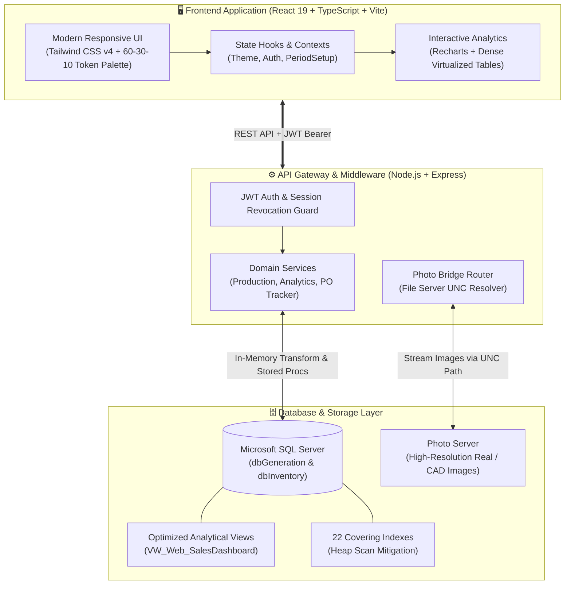

<div align="center">

# 💎 Jewelry Factory ERP & Production Intelligence Platform

**A full-stack, enterprise-grade manufacturing execution system (MES) and real-time operations dashboard built for high-throughput jewelry production facilities.**

[](https://react.dev/)
[](https://www.typescriptlang.org/)
[](https://nodejs.org/)
[](https://www.microsoft.com/en-us/sql-server)
[](https://tailwindcss.com/)
[](#)

[Features](#-key-capabilities) • [System Architecture](#-system-architecture) • [Tech Stack](#-technology-stack) • [Design System](#-design-system--ui-principles) • [Getting Started](#-getting-started)

---

</div>

## 📖 Executive Summary

The **Jewelry Factory ERP** is a modern web transformation of a legacy enterprise software suite (originally Windows Forms / Crystal Reports). Engineered to bridge the gap between business planning and factory-floor execution, it processes high-volume production orders across sterling silver and brass jewelry manufacturing lifecycles.

It serves as a **Single Source of Truth (SSOT)** for executive management, production controllers, QA inspectors, and sales account managers—providing low-latency visibility into multi-department bottlenecks, delivery forecasts, and order trends.

---

## ✨ Key Capabilities

### 1. 📊 Executive Operations & Production Forecast
- **Real-Time Bottleneck Analysis**: Tracks work-in-progress (WIP) across 17 distinct production stages (Wax Injection, Casting, Grinding, Setting, Polishing, Plating, QC, and Packing).
- **Stage Delta & Cumulative Backlog**: Mathematical stage difference tracking calculating departmental deficit in real-time.
- **Factory Output Trend**: Time-series analytics comparing historical output volumes by department and product categories (Rings, Earrings, Necklaces, Bracelets).

### 2. 📦 Production Order (PO) Tracker & Line Details
- **Multi-Axis Grouping**: Consolidates orders across 6 dimensions (`Customer`, `PO Number`, `Order Kind`, `Material`, `Address`, and `Customer Due Date`).
- **Packaging Checklist Matrix**: Tracking for barcodes, UPC tags, boxes, pouches, security tags, and scan verifications.
- **Micro-Level Photo Inspection**: Network-bridged product imagery with fallback protocols for CAD renders and real cost-sheet photography.

### 3. 📈 Customer Sales & Matrix Analytics
- **Customer Segmentation**: Automatic classification into major customer groups (`N008`, `N044`, `N051`, `N098`, `MLT`, `General`).
- **Dense Matrix Reporting**: 12-month calendar year-over-year comparison matrices supporting multi-metric toggles ($ USD Sales vs. Total Quantity in pieces).
- **Top Item Gallery**: Ranked visual showcase of top-performing jewelry designs by customer and year.

### 4. 🛡️ Enterprise Security & Admin Suite
- **Role-Based Access Control (RBAC)**: Fine-grained permission system differentiating Executive/Admin and Sales capabilities.
- **Stateless Session Management**: Real-time session monitoring with remote kill-switch mechanisms for security compliance.
- **Security Radar & Audit Trail**: Comprehensive logging for document locks, IP bans, and administrative modifications.

---

## 🏗️ System Architecture



---

## 🛠️ Technology Stack

| Layer | Technologies | Key Highlights |
| :--- | :--- | :--- |
| **Frontend** | React 19, TypeScript, Vite, Tailwind CSS v4 | Inversion of Control (IoC) Document Shell, Responsive Grid (100dvh fit), Zero-Layout Shift Skeletons |
| **Data Viz** | Recharts, Lucide Icons, ExcelJS | Customized Bar/Composed charts with square edges, dense Excel-like matrix reports |
| **Backend** | Node.js, Express, `mssql` pool driver | Robust connection pooling, In-memory stage delta calculation, Zero-DB-mutation guardrail |
| **Database** | Microsoft SQL Server (Enterprise) | 22 Covering non-clustered indexes, optimized view abstraction, legacy VB.NET SP backward compatibility |
| **Security** | JWT (JSON Web Tokens), bcrypt, Role Guards | Session tracking, brute-force locking, document concurrency lock management |

---

## 🎨 Design System & UI Principles

The system follows an operational **"Precision Control Room"** philosophy tailored for intense enterprise usage:

- **60-30-10 Color Hierarchy**:
  - `60% Canvas`: Subdued neutral workspace canvas (`--color-ui-canvas`).
  - `30% Surface`: High-contrast tables and container panels (`--color-ui-surface`).
  - `10% Accent`: Brand interaction focus (`--color-ui-interactive`).
- **Semantic Data States**: Distinct color usage reserved purely for meaningful metrics—Red for *Overdue/Late*, Green for *Shipped/Done*, Amber for *In-Progress*.
- **Tri-Theme Engine**: Full support for **Modern Dark** (default), **Dark Gold**, and **Royal White** with immediate theme switching.

---

## 🚀 Getting Started

### Prerequisites
- Node.js (v18.x or higher)
- npm or pnpm
- Access to an MS SQL Server instance (or local compatibility container)

### 1. Clone the repository
```bash
git clone https://github.com/nitipoomph-coder/jewelry-factory-ERP.git
cd jewelry-factory-ERP
```

### 2. Configure Backend Environment
```bash
cd "Jewelry Factory System/backend"
cp .env.example .env
```
Edit `.env` with your actual database and network share credentials:
```env
DB_HOST=localhost
DB_PORT=1433
DB_NAME=dbGeneration
DB_USER=sa
DB_PASS="YourSecurePassword"
PORT=3001
JWT_SECRET="super-secret-jwt-key"
```

### 3. Install Dependencies & Run Development
Open two terminal windows:

**Terminal 1: Backend**
```bash
cd "Jewelry Factory System/backend"
npm install
npm run dev
```

**Terminal 2: Frontend**
```bash
cd "Jewelry Factory System/frontend"
npm install
npm run dev
```

The web application will be accessible at `http://localhost:3000`.

---

## 📄 License & Confidentiality

This project is developed as a proprietary industrial system. All technical specifications, business logic formulas, and database abstraction layers have been sanitized for public demonstration and portfolio display.
